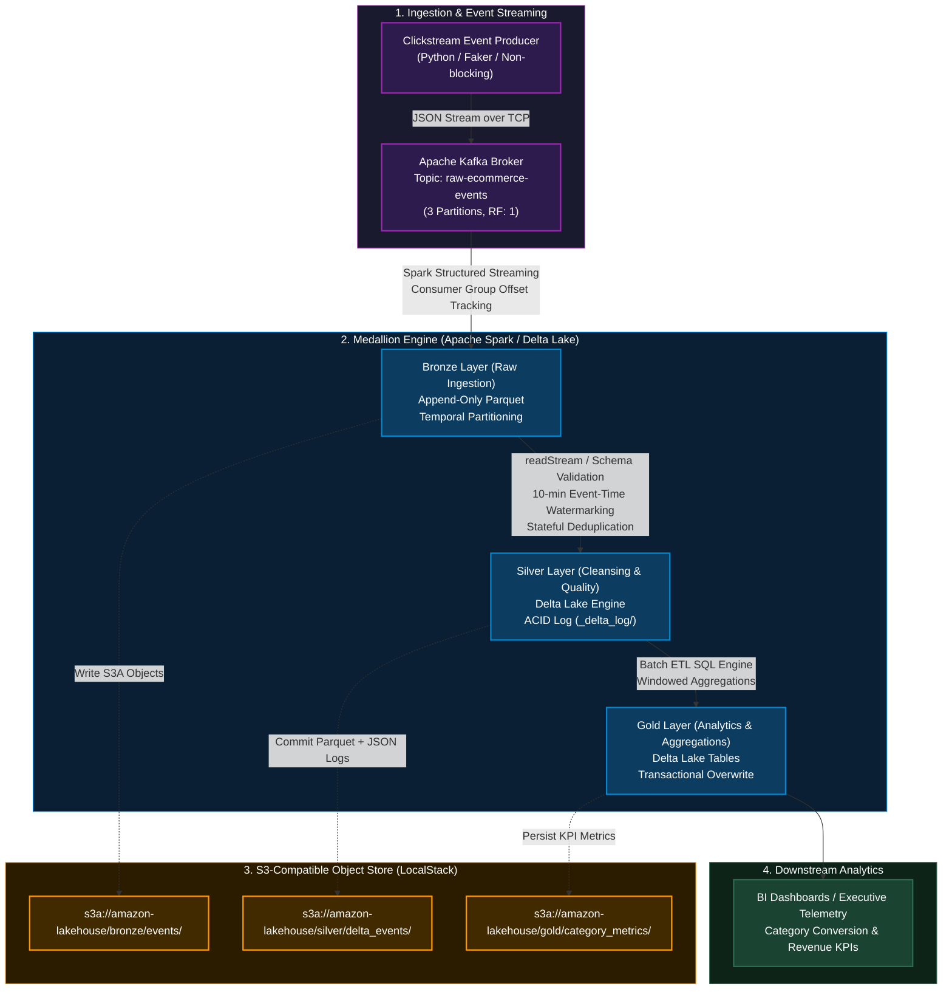

# Real-Time E-Commerce Medallion Lakehouse Pipeline

[](https://spark.apache.org/)
[](https://delta.io/)
[](https://kafka.apache.org/)
[](https://www.docker.com/)
[](https://localstack.cloud/)

An enterprise-grade, distributed streaming data pipeline implementing the **Medallion Architecture (Bronze → Silver → Gold)**. This system simulates a production AWS Lakehouse environment on local infrastructure, ingesting high-velocity clickstream event streams via **Apache Kafka**, performing stateful stream-stream processing and deduplication with **Apache Spark Structured Streaming**, enforcing ACID reliability using **Delta Lake**, and persisting objects in **LocalStack S3**.

---

## Architecture Overview



---

## Engineering Design & Medallion Specifications

### 1. Ingestion Layer (`src/producer.py`)

- **Transport:** Serialized JSON over Kafka TCP protocol.
- **Payload Contract:**

```json
{
  "event_id": "UUIDv4 (String)",
  "user_id": "String (user_1000 - user_1050)",
  "session_id": "UUIDv4 (String)",
  "event_type": "view_item | add_to_cart | remove_from_cart | purchase",
  "product_id": "String (prod_100 - prod_500)",
  "category": "Electronics | Footwear | Clothing | Books | Home",
  "price": "Double (Precision 2)",
  "device": "iOS | Android | Web",
  "ip_address": "IPv4 (String)",
  "timestamp": "ISO-8601 UTC (Timestamp)"
}
```

- **Reliability:** Configured with synchronous broker acknowledgment flushes to prevent internal client buffer drops.

### 2. Bronze Layer: Raw Data Ingestion (`src/streaming_bronze.py`)

- **Source:** Kafka broker cluster (`kafka:29092`), topic `raw-ecommerce-events`.
- **Processing Model:** Micro-batch processing triggered every 10 seconds.
- **Storage Strategy:** Append-only Parquet storage partitioned chronologically to preserve raw event lineage without schema mutation.
- **Fault Tolerance:** Dedicated checkpoint directory in S3 (`checkpoints/bronze_v1/`) recording micro-batch offsets and transaction states.

### 3. Silver Layer: Cleansing & ACID Delta Lake (`src/streaming_silver.py`)

- **Source:** Bronze S3 Parquet directory (`readStream`).
- **Quality Controls & Schema Enforcement:** Strict schema casting from raw string payloads to structured Spark data types.
- **State Management:**
  - **Watermarking:** Implements a 10-minute watermark (`withWatermark("timestamp", "10 minutes")`) to bound late-arriving event states.
  - **Deduplication:** Stateful `.dropDuplicates(["event_id", "timestamp"])` eliminates network retries and duplicate events.
- **Delta Lake Storage:** Persisted directly as a Delta Lake table at `s3a://amazon-lakehouse/silver/delta_events/`, guaranteeing transaction atomicity via JSON metadata commit logs (`_delta_log/0000000000000000000X.json`).

### 4. Gold Layer: Analytical Business Marts (`src/batch_gold.py`)

- **Source:** Silver Delta Lake table (`format("delta")`).
- **Aggregation:** Executes batch dimensional rollups by product category:
  - **Metric 1:** Total Raw Ingested Events (`total_events`)
  - **Metric 2:** Distinct User Engagement (`unique_users`)
  - **Metric 3:** Gross Revenue Contribution (`total_revenue` on verified purchase events)
  - **Metric 4:** Conversion Rate Percentage (`conversion_rate_pct = (total_purchases / total_events) * 100`)
- **Sink:** Materialized Delta KPI table written under `mode("overwrite")` to provide idempotent refresh for BI queries.

---

## Tech Stack & Runtime Matrix

| Subsystem | Framework / Technology | Artifact Details / Base Port |
| :--- | :--- | :--- |
| **Message Broker** | Apache Kafka | Confluent Platform 7.5.0 (`localhost:9092`, `kafka:29092`) |
| **Cluster Coordination** | Apache Zookeeper | Confluent Platform 7.5.0 (`zookeeper:2181`) |
| **Processing Engine** | Apache Spark | 3.5.0 (PySpark on OpenJDK 11) |
| **Table Storage Format** | Delta Lake Core | 3.1.0 (`io.delta:delta-spark_2.12:3.1.0`) |
| **Object Storage** | LocalStack S3 | Local AWS S3 Mock (`http://localhost:4566`, S3A API) |
| **Connectors & JARS** | Hadoop AWS & SDK | `hadoop-aws:3.3.4`, `aws-java-sdk-bundle:1.12.262` |
| **Containerization** | Docker Engine & Compose | Multi-tier bridge network (`bridge-net`) |
| **Scripting & Tooling** | Python & PowerShell | Python 3.10+, PowerShell 7+ |

---

## Repository Structure

```text
amazon-lakehouse-pipeline/
├── docker-compose.yml          # Container topology (Zookeeper, Kafka, Spark, LocalStack)
├── requirements.txt            # Python dependencies (boto3, kafka-python-ng, faker, delta-spark)
├── src/
│   ├── producer.py             # Event generation & Kafka stream producer
│   ├── streaming_bronze.py     # Bronze ingestion streaming job
│   ├── streaming_silver.py     # Silver transformation & Delta Lake streaming job
│   └── batch_gold.py           # Gold KPI analytical aggregation batch job
└── scripts/
    ├── setup_infra.ps1         # Infrastructure deployment & configuration orchestrator
    ├── run_bronze.ps1          # Spark-submit job launcher for Bronze layer
    ├── run_silver.ps1          # Spark-submit job launcher for Silver Delta layer
    ├── run_gold.ps1            # Spark-submit job launcher for Gold analytical batch
    └── teardown.ps1            # Clean container teardown & resource reclamation
```

---

## Quickstart & Execution Guide

### Prerequisites

- Docker Desktop installed with WSL 2 backend enabled.
- Python 3.10+ installed.
- PowerShell 5.1+ or PowerShell 7+.

### 1. Environment Preparation

```powershell
python -m venv venv
.\venv\Scripts\Activate.ps1
pip install -r requirements.txt
```

### 2. Infrastructure Deployment

Execute the orchestration script to provision containers, initialize S3 buckets, create Kafka topics, and resolve container file system permissions:

```powershell
.\scripts\setup_infra.ps1
```

### 3. Pipeline Execution

Open dedicated PowerShell terminals for each stage:

**Terminal 1: Bronze Ingestion Stream**

```powershell
.\venv\Scripts\Activate.ps1
.\scripts\run_bronze.ps1
```

**Terminal 2: Synthetic Event Producer**

```powershell
.\venv\Scripts\Activate.ps1
python src/producer.py
```

**Terminal 3: Silver Delta Lake Processing**

```powershell
.\venv\Scripts\Activate.ps1
.\scripts\run_silver.ps1
```

**Terminal 4: Gold KPI Aggregation Batch**

```powershell
.\venv\Scripts\Activate.ps1
.\scripts\run_gold.ps1
```

---

## Production Validation & Metric Telemetry

During verification, the pipeline processed **1,433 streaming events** end-to-end without record drop, producing the following analytical output in the Gold layer:

```text
>>> Total records loaded from Silver Delta Lake: 1433
>>> Category Metrics Preview:
+-----------+------------+------------+-------------+---------------+-------------------+
|category   |total_events|unique_users|total_revenue|total_purchases|conversion_rate_pct|
+-----------+------------+------------+-------------+---------------+-------------------+
|Footwear   |271         |50          |5465.19      |23             |8.49               |
|Home       |309         |51          |7068.84      |28             |9.06               |
|Books      |292         |51          |7802.01      |33             |11.3               |
|Electronics|268         |51          |7261.43      |29             |10.82              |
|Clothing   |293         |51          |7834.15      |26             |8.87               |
+-----------+------------+------------+-------------+---------------+-------------------+
>>> Successfully written aggregated KPI metrics to Gold Delta: s3a://amazon-lakehouse/gold/category_metrics/
```

---

## Transaction Log Verification

ACID transaction commits verified via LocalStack S3 metadata inspection:

- `silver/delta_events/_delta_log/00000000000000000000.json`
- `silver/delta_events/_delta_log/00000000000000000001.json`
- `silver/delta_events/_delta_log/00000000000000000002.json`

---

## Teardown & Maintenance

To safely terminate streaming jobs and decommission all containerized infrastructure:

1. Stop active streaming processes in Terminals 1, 2, and 3 using `Ctrl + C`.
2. Tear down Docker containers:

```powershell
.\scripts\teardown.ps1
deactivate
```

---

## 👨‍💻 Author & Maintainer

<p align="left">
  
</p>

### **Kazi Arsalan Ajaj Ahmed**
*Data Engineer & Lakehouse Architect*

[](https://github.com/arsalankazi)
[](https://linkedin.com/in/arsalankazi)
[](mailto:kaziarsalan810@gmail.com)

---

### 🎯 Core Engineering Focus

- **Streaming Architecture:** Kafka Event Ingestion, Spark Structured Streaming, Stateful Processing & Event-Time Watermarking.
- **Lakehouse Engineering:** Medallion Architecture (Bronze/Silver/Gold), Delta Lake ACID Transactions & Hive-Partitioned Storage.
- **Distributed Systems:** Fault-Tolerant Checkpointing, Exactly-Once Semantics & S3A Object Store Integration.